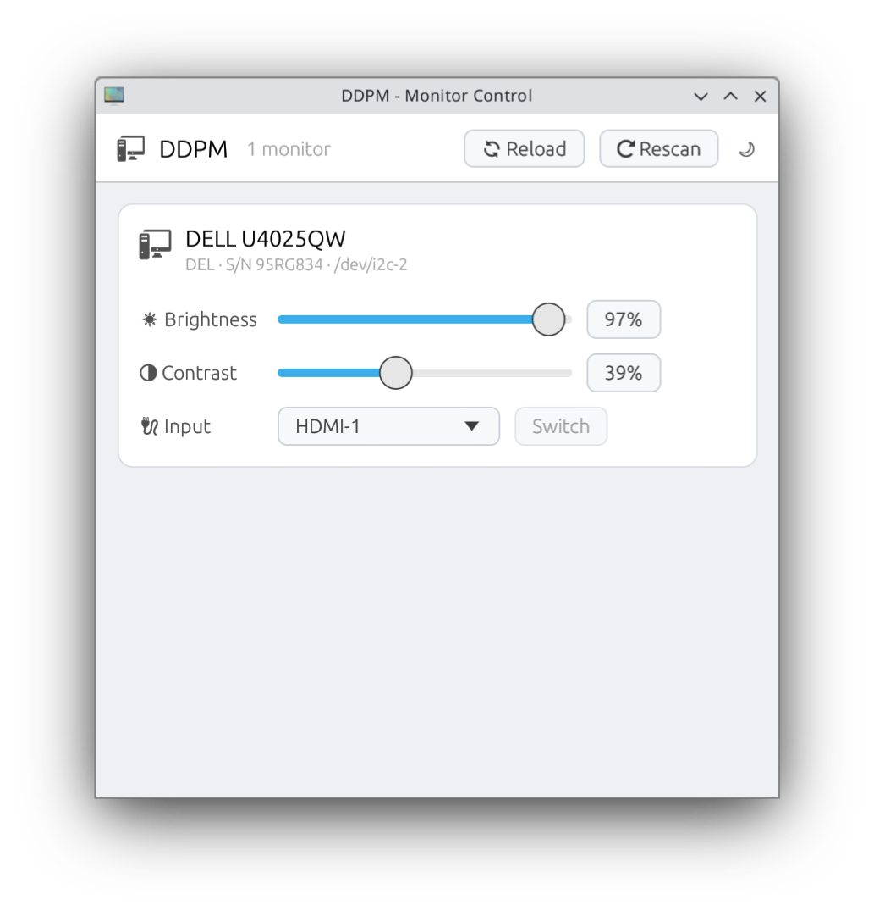

# DDPM

Monitor control for Linux and macOS — adjust **brightness**, **contrast** and **input source** of DDC/CI-capable monitors from a small desktop app.

[](https://github.com/chmelevskij/ddpm/actions/workflows/ci.yml)

<p align="center">
  <picture>
    <source media="(prefers-color-scheme: dark)" srcset="assets/screenshot-dark.png">
    
  </picture>
</p>

*Follows your system theme (dark/light), with a manual toggle in the toolbar.*

## Features

- Per-monitor brightness and contrast sliders — writes are throttled and coalesced, and the UI never blocks on the slow DDC/i2c protocol (all I/O runs on a worker thread)
- Input-source switching (DisplayPort / HDMI / USB-C / …) — each monitor lists its inputs as radio buttons (from the monitor's own capabilities); clicking one switches, with read-back
- Name your inputs (✏ next to each input, e.g. "Work laptop" instead of "DisplayPort-1"); names are remembered per monitor and also show in the tray / menu bar menu
- Keyboard shortcuts: every input gets one, ⌘1…⌘9 (Ctrl+1…9 on Linux), numbered across all monitors and shown next to the input; they work while the window is focused
- System tray icon (Linux: StatusNotifierItem, like the network/volume applets): scroll on it to adjust brightness, switch inputs straight from its menu, and closing the window hides to the tray — quit from the tray menu or with Ctrl+Q (on Wayland, restore the window from the taskbar; compositors don't let apps unminimize themselves)
- macOS menu bar icon: switch inputs, show/hide the window, rescan or quit from its menu (no scroll-to-adjust; macOS status items don't get scroll events)
- Rescan for hot-plugged monitors; values re-read on window focus, so changes made via the monitor OSD or `ddcutil` stay in sync
- Failed reads/writes are surfaced per monitor instead of silently ignored; misbehaving monitors get locked out after repeated failures with a Retry
- Monitors identified by model, serial and `/dev/i2c-N`

## Install

### From a release

Grab the latest `ddpm-*-x86_64-unknown-linux-gnu.tar.gz` from
[Releases](https://github.com/chmelevskij/ddpm/releases), unpack it, and put `ddpm` on your `PATH`
(the tarball also contains `ddpm.desktop` for your application launcher; point its `Exec=` at the binary's location).

### macOS

Grab `ddpm-*-universal-apple-darwin.zip` from [Releases](https://github.com/chmelevskij/ddpm/releases),
unzip it and move `DDPM.app` to Applications. The app is ad-hoc signed, not notarized, so the first
launch needs right-click → **Open** (or `xattr -dr com.apple.quarantine DDPM.app`).

No extra setup is needed on macOS; DDC/CI goes through the system display services on both Apple
Silicon and Intel Macs. On Apple Silicon, the built-in HDMI port of some models (e.g. M1 Mac mini)
does not pass DDC; USB-C / DisplayPort connections do.

### From source

Requires Rust, [`just`](https://github.com/casey/just), and on Debian/Ubuntu: `pkg-config` and `libudev-dev` (`just deps`).

```sh
just install     # Linux: cargo install + desktop entry; macOS: universal DDPM.app into ~/Applications
just uninstall   # remove it again
```

`just install-system` / `just uninstall-system` (sudo, `/usr/local`) are Linux-only.

## First-time system setup (Linux)

Your user needs access to the i2c device nodes:

```sh
just setup-i2c   # idempotent: i2c-dev module, `i2c` group, udev rule (uses sudo)
just doctor      # shows whether this machine is ready
```

Log out and back in after being added to the `i2c` group.

## Development

```sh
just             # list all recipes
just run         # run a debug build
just run-debug   # …with DDC-stack debug logging
just lint        # rustfmt check + clippy (warnings are errors)
just test        # unit tests
just ci          # lint + test + release build
```

## Releases & commit convention

This repo uses [Conventional Commits](https://www.conventionalcommits.org) and
[release-plz](https://release-plz.dev): pushes to `main` with releasable commits produce a release PR
(version bump + changelog); merging it tags the release, and CI builds and attaches the Linux binary and the macOS app
to the [GitHub release](https://github.com/chmelevskij/ddpm/releases).

| prefix | effect |
| --- | --- |
| `fix:` | patch release |
| `feat:` | minor release |
| `feat!:` / `BREAKING CHANGE:` | major release |
| `docs:` `ci:` `chore:` `refactor:` `test:` | no release on their own |

## License

[MIT](LICENSE)
